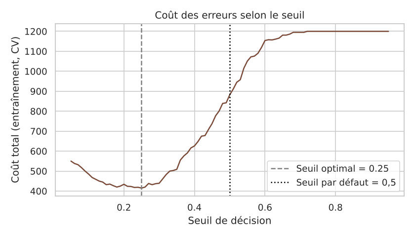
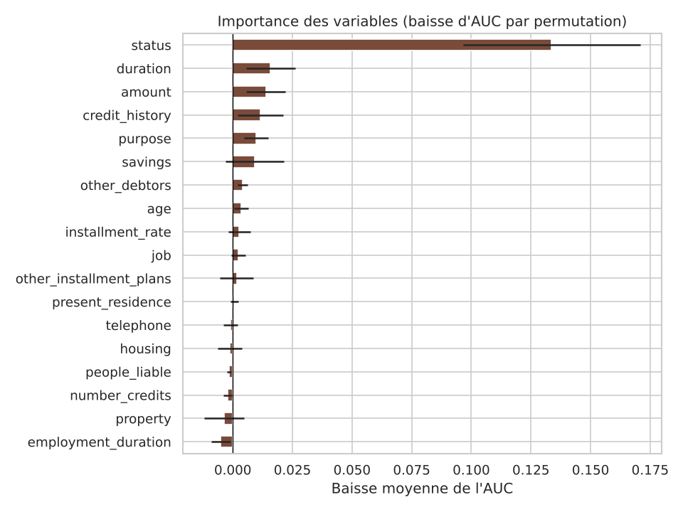

# 💳 Scoring client : prédire le risque de défaut de crédit

Ce projet construit un modèle de **scoring de crédit** : il estime la probabilité qu'un client ne rembourse pas son prêt, puis choisit un **seuil de décision** qui tient compte du coût réel des erreurs.

## 🎯 Résultats clés

| | Seuil par défaut (0,5) | Seuil optimisé (0,25) |
|---|---|---|
| AUC (jeu de test) | 0,80 | 0,80 |
| Défauts détectés (rappel) | 35 % | **85 %** |
| Coût total des erreurs | 204 | **109 (−47 %)** |

- Meilleur modèle : **forêt aléatoire**, retenue après comparaison de 4 modèles en validation croisée.
- Variable la plus déterminante : le **solde du compte courant**, devant la durée et le montant du crédit.
- Les variables **sexe** et **nationalité** sont exclues du modèle pour éviter une discrimination.



## 📊 Données

[German Credit](https://archive.ics.uci.edu/dataset/573/south+german+credit+update) : 1 000 demandes de crédit décrites par 20 variables (solde du compte, durée, montant, historique de crédit, épargne, emploi…). 30 % des clients sont en défaut. C'est un jeu de données de référence en scoring.

## 🛠️ Démarche

1. **Exploration** : répartition de la cible, variables numériques, taux de défaut par catégorie.
2. **Préparation**, dans un `Pipeline` scikit-learn pour éviter toute fuite de données :
   - traitement des **valeurs extrêmes** par plafonnement (1er et 99e percentiles) ;
   - **standardisation** des variables numériques ;
   - **encodage one-hot** des variables catégorielles.
3. **PCA** : 23 composantes expliquent 90 % de la variance des 55 variables encodées.
4. **Comparaison de modèles** en validation croisée stratifiée à 5 plis : régression logistique, régression logistique + PCA, forêt aléatoire, gradient boosting.
5. **Évaluation** sur un jeu de test mis de côté (20 %) : AUC, accuracy, précision, rappel, F1, matrice de confusion, courbe ROC.
6. **Choix du seuil de décision** : accorder un crédit à un client qui fera défaut coûte 5 fois plus cher que refuser un bon client. Le seuil qui minimise ce coût est choisi en validation croisée sur l'entraînement, puis appliqué au test.
7. **Interprétation** : importance des variables par permutation.

| Modèle | AUC (validation croisée) |
|---|---|
| **Forêt aléatoire** | **0,792 ± 0,040** |
| Gradient boosting | 0,775 ± 0,034 |
| Régression logistique + PCA | 0,774 ± 0,058 |
| Régression logistique | 0,763 ± 0,057 |



## 🚀 Lancer le projet

```bash
git clone https://github.com/AMINATA1999/scoring-client.git
cd scoring-client
pip install -r requirements.txt
jupyter notebook scoring_client.ipynb
```

## 📁 Structure

```
scoring-client/
├── scoring_client.ipynb     # Notebook complet, de l'exploration à la conclusion
├── data/
│   └── credit_allemand.csv  # Jeu de données German Credit
├── figures/                 # Graphiques générés par le notebook
└── requirements.txt
```

## ⚠️ Limites

- Petit jeu de données (1 000 clients), ancien : les résultats ne sont pas transposables tels quels à une banque actuelle.
- La matrice de coûts 5/1 est une convention ; dans un cas réel, elle serait définie avec le métier.
- Retirer les variables sensibles ne garantit pas l'absence de biais : une analyse d'équité serait la prochaine étape.

## 🧰 Outils

Python · pandas · NumPy · scikit-learn · Matplotlib · seaborn · Jupyter

## 👩‍💻 Autrice

**Ndeye Aminata Gadiaga**
[LinkedIn](https://linkedin.com/in/ndeye-aminata-gadiaga-26a97725b) · [GitHub](https://github.com/AMINATA1999)
